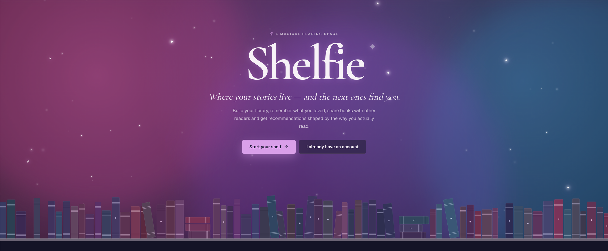
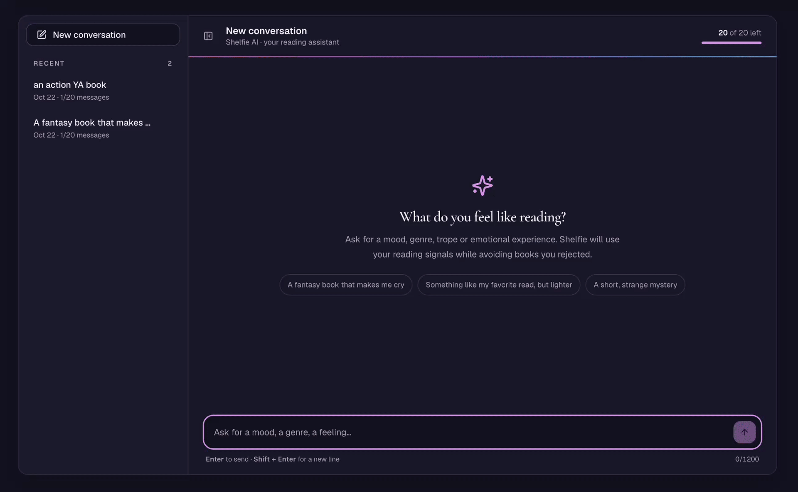
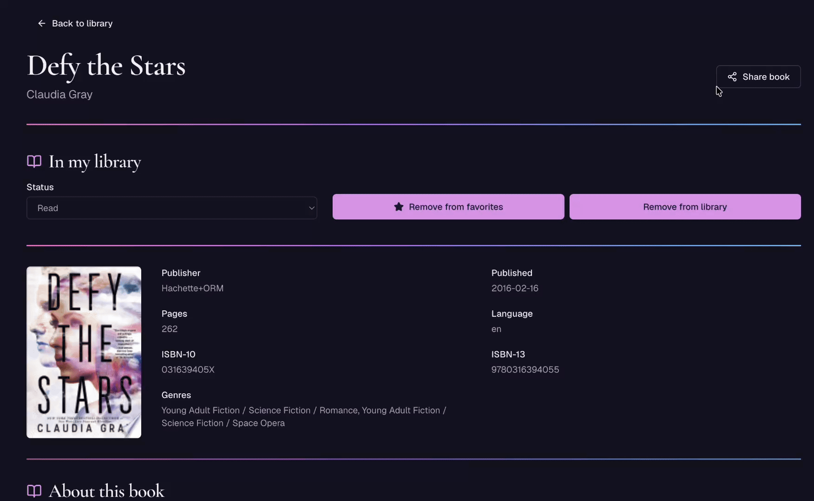
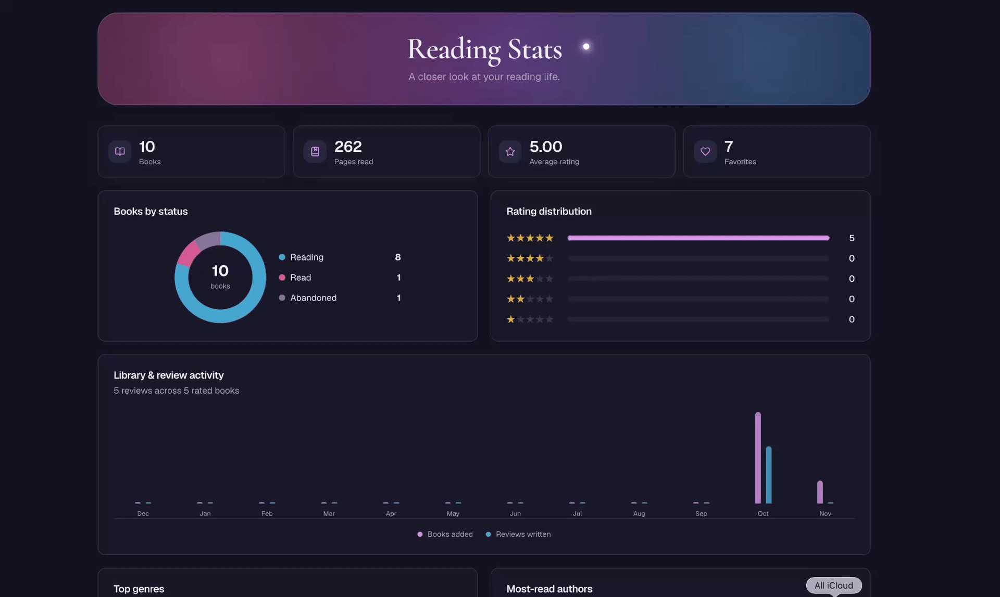

<h1 align="center">✨ Shelfie ✨</h1>

<p align="center">
  <strong>Your library, your people, and recommendations that actually know you.</strong>
</p>

<p align="center">
  Track what you read, remember what you loved, share books with friends,<br />
  and let an AI reading companion help you find what comes next. 🩷
</p>

<p align="center">
  
  
  
  
  
  
  
</p>

<p align="center">
  
</p>

<p align="center"></p>

<p align="center">
  <a href="#-about">About</a> ✦
  <a href="#-features">Features</a> ✦
  <a href="#-how-recommendations-work">Recommendations</a> ✦
  <a href="#-privacy--safety">Privacy</a> ✦
  <a href="#-accessibility">Accessibility</a> ✦
  <a href="#-development-process">Development</a> ✦
  <a href="#-running-locally">Run it</a>
</p>

## 🌙 About

Most reading trackers feel like spreadsheets. **Shelfie** is meant to feel like a small corner of the night sky made for readers. It has literary typography, book covers front and center, soft sparkles and animations, and light and dark themes that both feel warm.

Underneath that atmosphere is a complete social reading app. You can:

- build a library and review what you read;
- follow other readers and send books to friends;
- see your reading life in charts;
- get personalized recommendations from an AI that reads your **whole shelf**, including your ratings, favorites and the words you wrote in your reviews.

<p align="center"></p>

## ✨ Features

### 📚 Search & book pages

  

Search millions of titles through the **Google Books API** right from the home page. Results are paginated, and covers load through a dedicated proxy so they stay fast and reliable. Each book has its own page with:

- cover, author, publisher, publication date and full description;
- your actions in one place: add to your library, save to your wishlist, mark as a favorite, review, or share;
- reviews from other readers, with **the people you follow shown first**.

<p align="center">
  
</p>

### 📖 Your library

  

Your library is your personal shelf:

- Shelve books as **Read**, **Reading** or **Abandoned**. Abandoning a book is allowed here, and it also helps your recommendations.
- Make each book **public or private**, so your profile shows only what you choose.
- Mark the books that changed you as **favorites**.
- **Filter** by reading status, favorites or visibility, with a live "showing X of Y" count.

### ⭐ Ratings & reviews

  

The review form asks three things:

1. **Where are you in this story?** Your reading status.
2. **How did it feel?** A 1–5 star rating, which you can also pick with the arrow keys.
3. **Leave a few words.** An optional written review.

You decide whether the review is shared with the reading circle, and you can edit it later.

### 🌙 Private wishlist

 

Save the books you're curious about in a wishlist that **only you can see**, kept separate from your library. The AI also checks it: when something on your wishlist matches what you're asking for in the chat, it brings it up.

### 💫 For you: personalized recommendations

  

Each round gives you **six picks** made from your real reading:

- **Half are books you may have heard of**, and half are **lesser-known finds**, like small-press, translated, backlist and cult books that aren't the usual bestsellers.
- Every book comes with **a short reason** explaining why it fits you.
- Every book is **verified on Google Books** before it shows up, so you never get a title that doesn't exist.
- Picks **stream in one by one** as they're verified, so you don't wait for the whole list.
- **Not interested** removes a book for good. Books from your last five refreshes are skipped, so every refresh brings something new.
- The current set is saved, so coming back to the page is instant.

<p align="center">
  
</p>

### 🤖 AI reading chat

  

Start with a feeling, a genre, or a book you want to move away from:

> *"I want something similar to The Secret History, but lighter and with more mystery."*

If you're not sure what to ask, there are starter prompts like *"A fantasy book that makes me cry"* or *"A short, strange mystery"*.

- Answers use the **same reading context** as your recommendations.
- Suggestions appear as **book cards** with cover, author, the reason it was picked, a link to the book page and a *Not interested* action.
- Wishlist matches are marked **"From your wishlist"**.
- If a book can't be verified on Google Books, the assistant still names its title and author in plain text.
- Conversations are **saved in a sidebar**, so you can return to them or delete them.

<p align="center">
  
</p>

### 🧑‍🤝‍🧑 Readers, together

   

- **Profiles** have a photo, a bio and your public library. Search for readers by username.
- **Follow** other readers and look through their shelves. Follower counts are public, but only you can see your full lists.
- **Share a book** with anyone you follow, with an optional note. You can share any book, even one that isn't on your shelf yet:
  > *"Please read this, I need someone to talk about it with."*
- **Shared books** collects everything your friends have sent you.
- **Notifications** let you know about new followers and shared books. They have an unread badge, "mark as read" and delete.

<p align="center">
  
</p>

### 📊 Reading stats

  

The stats page gives you a closer look at your reading life:

- **Pages read**, **average rating** and **favorites** at a glance;
- **Books by status** and **rating distribution**;
- **Library and review activity** over the last 12 months;
- **Top genres** and **most-read authors**.

<p align="center">
  
</p>

### ⚙️ Account

The Account page holds your **profile editor** (photo up to 2 MB and bio), your followers and following lists, the **AI personalization** switch, **keyboard shortcuts**, links to the legal pages, and **permanent account deletion**.

### 🎨 Look & feel

- An **animated landing page** under a starry sky that introduces Shelfie chapter by chapter, with a live demo of the chat.
- **Light and dark themes**, each with its own palette, plus a "follow the system" option.
- **Responsive** from phones to wide screens.
- Thoughtful loading and empty states, friendly error messages with retry, and a custom 404 page.

<p align="center"></p>

## 🔮 How recommendations work

<p align="center">
  
  ➜
  
  ➜
  
  ➜
  
</p>


Shelfie gathers your signals and gives each one a weight. What you **wrote in your reviews** counts the most, followed by **ratings**, **favorites** and **reading status** (abandoned counts as a negative). Recurring authors, themes and genre come after that, and the wishlist is the lightest hint. A harsh review outweighs a simple genre match.


Gemini proposes a set of candidates, split between well-known and lesser-known books, each with a short reason. It skips anything already in your library, on your wishlist, marked *Not interested* or shown recently. If a model stalls, a fallback model takes over.


Each candidate is matched against Google Books by title and author. Only books that match make it to your screen.


The final set is cached until you ask for a new one, with a short cooldown between refreshes.

<p align="center"></p>

## 🔒 Privacy & safety

   

- **AI is off by default.** A single switch in **Account** controls both recommendations and the chat. While it's off, none of your reading data is sent to Gemini.
- **You choose what's public**, book by book and review by review. The wishlist is always private.
- **Row Level Security** on every table, so each reader can only read and change what they're allowed to.
- Reviews and book descriptions are treated as **data, not instructions**, so text inside them can't hijack the AI.
- **Privacy Policy and Terms of Use**, with explicit acceptance and an **18+ confirmation** at sign-up.
- **Delete your account** permanently whenever you want.
- The chat is limited to **20 messages per conversation** and **1,200 characters per message**.

<p align="center"></p>

## ♿ Accessibility

  

Shelfie can be used **entirely from the keyboard**. It has visible focus states, dialogs that keep focus inside them, keyboard-friendly star ratings and labelled controls throughout.

For faster navigation, you can turn on **keyboard shortcuts** in Account:

| Keys | Action |
|---|---|
| <kbd>g</kbd> then <kbd>d</kbd> · <kbd>r</kbd> · <kbd>c</kbd> · <kbd>l</kbd> · <kbd>w</kbd> | Dashboard · For you · AI chat · Library · Wishlist |
| <kbd>g</kbd> then <kbd>s</kbd> · <kbd>t</kbd> · <kbd>p</kbd> · <kbd>n</kbd> · <kbd>a</kbd> | Shared books · Stats · Profiles · Notifications · Account |
| <kbd>/</kbd> | Focus the search box |
| <kbd>?</kbd> | Show all shortcuts |
| <kbd>Esc</kbd> | Close a menu or dialog |

<p align="center"></p>

## 🌱 Development process

 

Shelfie was built **one feature at a time**, and each step left a working app behind. It went from a secure foundation (auth and Row Level Security) to the core reading loop (search, library, reviews), then the social layer, then a full visual redesign. The AI came last, so it could build on everything readers had already added. The final stretch went into polish: legal pages, account deletion, accessibility and the landing page.

**Highlights:**

- **Versioned database:** every schema and policy change lives in a Supabase migration.
- **Defensive AI pipeline:** model output is streamed, validated and matched against Google Books, with a fallback model and a deadline.
- **Tested logic:** book matching, stream parsing and keyboard shortcuts have unit tests.

<p align="center"></p>

## 🧰 Tech stack

| Area | Technology |
|---|---|
| Framework |    |
| Styling |    |
| Auth & database |    |
| Book data |  |
| AI |  |
| Hosting |  |

<p align="center"></p>

## 🛠️ Running locally

 

<details>
<summary><strong>Setup instructions</strong></summary>

<br />

**Requirements:** Node.js 20+, a Supabase project with the migrations in [`supabase/migrations`](supabase/migrations) applied, and API keys for Google Books and Gemini.

Create a `.env.local` file:

```bash
NEXT_PUBLIC_SUPABASE_URL=your_supabase_project_url
NEXT_PUBLIC_SUPABASE_PUBLISHABLE_KEY=your_supabase_publishable_key
SUPABASE_SECRET_KEY=your_supabase_secret_key   # used for account deletion
GOOGLE_BOOKS_API_KEY=your_google_books_api_key
GEMINI_API_KEY=your_gemini_api_key
GEMINI_MODEL=gemini-3.5-flash-lite              # optional
```

Then:

```bash
npm install
npm run dev        # http://localhost:3000
```

Checks:

```bash
npm run lint
npm test
npm run build
```

</details>

<br />

<p align="center">
  
  <br />
  <em>✦ Built one page, one feature, and one book at a time. ✦</em>
</p>
